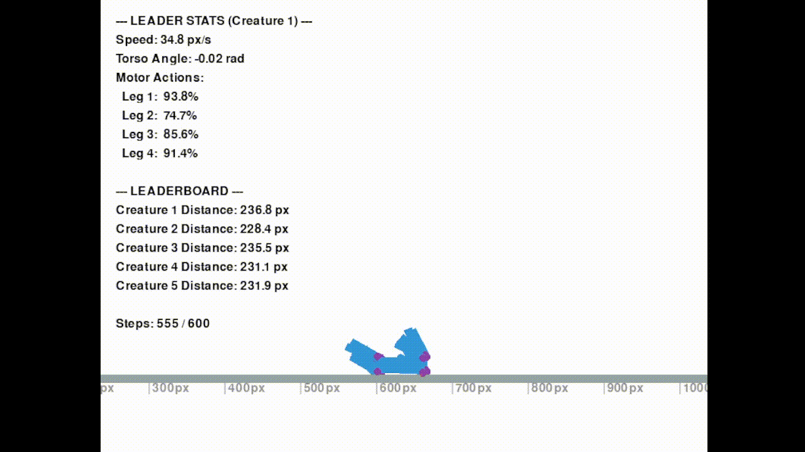

# Evolution-1

A 2D physics lab where creatures learn to walk through evolution, not backprop.

No reinforcement learning frameworks in the default path. No PyTorch Lightning. No 40-package dependency hell. Just a genetic algorithm, a tiny neural net, and Pymunk doing all the heavy lifting. (An optional PPO baseline sits behind `pip install -e .[rl]`, for comparison only.)



---

## What this actually is

A quadruped creature (torso + 4 legs, all Pymunk rigid bodies) gets a small neural network brain - 15 inputs, one hidden layer of 16 neurons, 4 motor outputs. That's 324 parameters total. No gradients. No loss functions.

Each generation, the top 5 performers survive. The rest of the population is bred from crossovers between survivors, then mutated. Repeat. After enough generations the creature figures out how to walk forward without falling over - entirely from scratch, with no demonstration data.

The training signal is dead simple: **go right, don't fall**.

**Learning the codebase?** Start with [docs/LEARNING.md](docs/LEARNING.md): one module per layer (NumPy brain, physics, reward, evolution, parallelism, web, 3D, deploy), with study links and questions to check you can explain each part.

### How the state space works

The 15 network inputs at each timestep:

| Input | What it is |
| --- | --- |
| `torso_angle` | Body tilt |
| `torso_angular_velocity` | How fast it's rotating |
| `torso_velocity_x/y` | Forward/vertical speed |
| `torso_height` | How far off the ground |
| `leg[0..3].angle` | Each leg's angle relative to torso |
| `leg[0..3].angular_velocity` | Each leg's rotation speed |
| `cpg_sin, cpg_cos` | Central Pattern Generator clock (30-step rhythm signal) |

With `knees=True` (research runs only) there are 8 more inputs (per knee: shin angle relative to the thigh, shin angular velocity x 0.1) and 4 more outputs (the knee motors), so the network is 23→16→8.

The CPG is a precomputed sine/cosine table that gives the network a sense of rhythmic timing - it can phase-lock its gait to it. Without it, the creature tends to spam all motors at max speed and goes nowhere.

### Evolution loop

```
evaluate all N genomes (parallel, one rollout per core)
    ↓
rank by cumulative reward
    ↓
keep top 5 (elite carry-through)
    ↓
fill population:
  15% chance  → mutate one elite
  85% chance  → crossover two elites, then mutate result
    ↓
repeat
```

Mutation: per-parameter random mask (rate 0.15) with Gaussian noise (scale 0.35). Crossover: uniform parameter-level mixing (50/50 per weight from each parent).

---

## Research track: Evolving Virtual Creatures

This repo is also applying ideas from Karl Sims' "Evolving Virtual Creatures" (1994), one idea per PR. Each step is documented in `docs/evolving-virtual-creatures/NN-step/` with a plan, abstract and results; the roadmap is in [docs/evolving-virtual-creatures/README.md](docs/evolving-virtual-creatures/README.md).

**Step 1, knees (exp3, done).** Optional thigh+shin legs with powered one-way knees: 23 inputs, 8 outputs, 520 weights.
- Result: straight 394 px IQM vs knees 160 px on held-out test courses; the knees fell on 100/100 test episodes vs 17/100.
- The cause was traced to a geometric fall rule plus a leaking soft knee limit.
- Details: [01-knees/results.md](docs/evolving-virtual-creatures/01-knees/results.md) and the blog draft [docs/blog/01-knees-part-1.v2.md](docs/blog/01-knees-part-1.v2.md).

**Step 2, knees v2 (in progress).**
- `fall_rule="penalty"` (-2 per step with the torso on the ground, instead of death), knee limits enforced in code, and a Spot-inspired `knees="spot"` variant.
- Opt-in `guards`: hip clamp, a physics sanity cutoff (those episodes are marked `invalid`), and a progress-based stuck rule.
- exp4 is planned (`experiments/exp4_knees_v2.json`).

Every code change in steps 1 and 2 is listed in [knees-changes.md](docs/evolving-virtual-creatures/knees-changes.md). Session logs are in [docs/log/](docs/log/).

---

## The terrain

Flat ground from spawn (x=400) to x=600. Then, as `legacy_course()` in `src/terrain.py` builds it (the default, kept bug-for-bug so old models and replays still match):
- **Uphill** from x=600 to x=1600 (40px rise over 1000px)
- A 40px drop at x=1600, then a **second uphill** to x=2600 (meant to be a downhill: the second segment reuses the uphill's formula)
- Another 40px drop at x=2600 back to the flat ground, which ends at x=3000

There's no goal check in the env: an episode ends after 600 steps, a fall, or getting stuck. The best walker currently reaches about x=900, partway up the first hill.

`fixed_course()` is the intended course with a real downhill. Experiments use `random_course()`: seeded piecewise-linear courses (train/control slopes up to 4%, test slopes 5-8%).

---

## 3D view

The physics is still 2D. The dashboard draws it in 3D with [Three.js](https://threejs.org/) (0.160.1 from jsDelivr, no build step): torso and leg boxes, the terrain extruded into a strip with distance ticks every 100 px, and a follow camera. The legs are spread across depth so the pairs read as a quadruped. If WebGL is unavailable it falls back to the 2D canvas, and the 3D/2D button switches between them.

What it plays is a **recorded replay**, not a live simulation. The physics is chaotic: a 1e-6 difference in the network's forward pass (different CPU or BLAS kernel) makes the same brain walk differently, so a server can't be trusted to reproduce a walk you checked locally. `scripts/record_replay.py` runs one episode per dashboard model (`best`, `universal`, `random` with a fixed seed) and writes `web/static/replays/<model>.json` (about 76 KB each). Visitors download that file once and the browser plays it back, so the server does no simulation per viewer. Re-run the script after training and commit the output.

When training is enabled (`TRAINING_ENABLED=1`, the local default), a **Live (server)** button also streams the episode from `/api/stream/sim`. The public demo never opens that stream.

---

## MuJoCo track (3D physics)

`mujoco/evolution/` re-runs the same genetic algorithm on [MuJoCo](https://mujoco.org/), a real 3D physics engine. The GA and `CreatureBrain` are imported from `src/` unchanged - the environment only has to provide `reset()` and `step(action) -> (obs, reward, done, fallen)`, so only the physics is new.

**The dog** (`scripts/mujoco_env.py`, model `models/smoke.xml`):
- 26 observations: 8 hinge angles, 8 hinge velocities, torso height, torso quaternion (w, x, y, z), torso angular velocity (3), linear velocity x/y. 8 motor outputs, so the brain is 26→16→8 (568 weights).
- Reward is `2 x forward distance` plus a one-time 1000 bonus for crossing 2 m. An episode ends after 600 steps or when the torso drops below 0.25 m.
- It also logs each foot's touchdown/liftoff and stance time, so a gait can be inspected instead of just scored.

**Any model** (`scripts/generic_env.py`): joints and actuators are discovered from the MJCF, so a 12-DoF biped (Berkeley Humanoid, the default `models/berkerly model.xml`) or the Spot description in `models/boston_dynamics_spot/` both work. Observations are `2 x n_joints + 10`; `<position>` actuators get a target angle, `<motor>` actuators a torque. Reward is velocity + upright + alive, minus lateral drift and energy, and the episode ends when the torso tips past 0.5 or drops below 60% of home height. Compiled models are cached, since the GA builds a fresh env per genome.

**C port** (`mujoco/evolution/c/`): headless `ga_train.exe` and `play_best.exe` - same algorithm, same `.npz` weights, no Python at run time. Build and usage: [mujoco/evolution/c/README.md](mujoco/evolution/c/README.md).

### MuJoCo setup

MuJoCo is not in `requirements.txt`. It lives in its own gitignored venv so the core 2D install stays light (built against MuJoCo 4.0):

```powershell
python -m venv .venv-mujoco
.venv-mujoco\Scripts\pip install mujoco mujoco-menagerie numpy
```

Run the scripts with that interpreter, from the repo root.

### Train and watch

```powershell
# evolve the dog: writes results/history.csv + models/best_mujoco.npz
.venv-mujoco\Scripts\python mujoco\evolution\scripts\ga_train.py --generations 30 --pop 20 --workers 4

# replay the saved brain in the MuJoCo viewer (Esc closes)
.venv-mujoco\Scripts\python mujoco\evolution\scripts\play_best.py

# same for any MJCF with a free joint + actuators
.venv-mujoco\Scripts\python mujoco\evolution\scripts\ga_train_generic.py --xml "mujoco/evolution/models/boston_dynamics_spot/scene.xml" --generations 30 --pop 20
.venv-mujoco\Scripts\python mujoco\evolution\scripts\play_generic.py --xml "mujoco/evolution/models/boston_dynamics_spot/scene.xml"
```

Both trainers take `--generations --pop --workers --max-steps --mutation-rate --mutation-scale --seed`; the generic one adds `--xml --action-scale --fall-penalty`. The `play_*` scripts take `--episodes 0` (loop forever), `--speed`, and `--headless`.

One caveat: the folder is literally named `mujoco/`, which shadows the pip package. The scripts work around it by appending the repo root to `sys.path` instead of prepending it - any new code under `mujoco/` has to import the same way.

---

## Quick start

```bash
pip install -r requirements.txt   # server + training (flask, gunicorn, numpy, pymunk)
pip install pygame matplotlib     # optional: local pygame viewer and plots (or: pip install -e .[viz])
```

**Run the best saved model:**
```bash
python main.py --render
```

**Train from scratch:**
```bash
python main.py --train --gens 100 --pop 50 --workers 4
```

**Web dashboard** (3D replay view, start/pause/tune training from the browser):
```bash
python app.py
# open http://localhost:8000
```

**Refresh the dashboard replays** after training (writes `web/static/replays/*.json`, commit them):
```bash
python scripts/record_replay.py
```

**Plot training history:**
```bash
python scripts/plot_logs.py
python scripts/plot_logs.py --live  # tails an active run
```

**Research experiments** (laptop-only extras: scipy, cma, matplotlib):
```bash
pip install -e .[research]
python scripts/run_experiment.py experiments/smoke.json --workers 2   # about 2 minutes
python scripts/analyze.py results/smoke                               # stats, F1-F10, REPORT.md
python scripts/run_experiment.py experiments/exp1_cpg.json --workers 6  # overnight: 120 runs
python scripts/verify_results.py results/exp1_cpg                     # before publishing to git
python scripts/export_dashboard.py results/exp1_cpg                   # dashboard Experiments tab
```
Each run writes `results/<exp>/<variant>/seed_<n>/` and is skipped once it has `DONE`, so an interrupted experiment resumes where it stopped. Hypotheses and the analysis plan are pre-registered in `experiments/HYPOTHESES.md`; tag it before the first full run.

**Training on GitHub Actions** (`.github/workflows/experiment.yml`):
- Push a branch named `experiment/<config-name>` and it runs `experiments/<config-name>.json` as one job per (variant, seed). `workflow_dispatch` works once the file is on the default branch.
- A collect job merges the runs, verifies and analyzes them (`--no-replay`), and uploads the artifact `results-<name>`.
- Download it with `gh run download <id> -n results-<name> -D results/<name>`.
- Champions trained on Linux CI can replay differently on Windows or macOS (chaotic physics), so run replays on the same platform.

**Docker:**
```bash
docker compose up --build
```

---

## Deploy (Render)

Runs as a Render web service straight from the `Dockerfile` (runtime: Docker, free plan). Render sets `PORT` and gunicorn binds to it.

| Env var | What it does |
| --- | --- |
| `TRAINING_ENABLED` | `0` = watch-only public demo (start button is off, `/api/training/start` returns 403). `1` (default) lets you train from the dashboard. |
| `TRAINING_WORKERS` | Process count for training. Default 4, use `1` on the free tier. |

Free tier heads-up: it sleeps after ~15 min idle (~1 min cold start), and there's no persistent disk, so anything trained on the server resets on every deploy. The committed `data/models/` and `data/logs/` are what the demo shows.

---

## Stack

| Piece | Why |
| --- | --- |
| **Pymunk** | 2D rigid body physics - fast, no GPU needed |
| **MuJoCo** (optional) | 3D physics for the `mujoco/` track: articulated legs, contacts, quaternions. Same GA, same brain |
| **NumPy** | The brain is 324 weights: two matmuls + `tanh`, plus crossover/mutation on plain arrays. No deep learning framework needed |
| **Flask + SSE** | Real-time browser streaming without WebSockets |
| **Python multiprocessing** | Parallel rollout evaluation across CPU cores |
| **Matplotlib** | Training curve visualization |

No Ray. No Stable-Baselines. No CUDA required.

---

## Fitness modes

The `--fitness-mode` flag changes what penalties get applied during rollout:

| Mode | What it does |
| --- | --- |
| `baseline` | Reward = forward displacement only |
| `tilt_penalized` | Also penalizes body angle deviation |
| `energy_penalized` | Also penalizes total motor effort |
| `ground_termination` | Episode ends immediately on torso contact |
| `all_penalties` | Tilt + energy penalties combined |

Research runs also take `fall_rule` (`touch` default / `penalty`) and `guards` in `RunConfig`; see `src/research/config.py`.

---

## Project layout

```
main.py            - Command-line training (python main.py --train)
app.py             - Flask web dashboard; this is what Render runs
src/
  environment.py   - Pymunk physics world, creature construction, reward logic
  evolution.py     - Population class, crossover, mutation, rollout dispatch
  model.py         - CreatureBrain (15→16→4 tanh network, or 23→16→8 with knees)
  terrain.py       - Course builders (legacy, fixed, seeded random)
  gym_env.py       - Gymnasium wrapper (Evolution1-Quadruped-v0)
  rl/              - Optional PPO baseline: envs, tanh policy, CreatureBrain export, trainer
  research/        - Seeded experiments: optimizers, evaluation, stats, figures
data/models/       - Saved checkpoints (best_model.npz, top_0..4.npz)
data/logs/         - history.csv (tracked, drives the chart); evolution.log (local only)
web/templates/     - Dashboard HTML
web/static/replays/ - Recorded episodes the dashboard plays back (scripts/record_replay.py)
experiments/       - Experiment configs and pre-registered hypotheses
notebooks/         - playground.ipynb (Colab or local)
scripts/           - record_replay.py, run_experiment.py, analyze.py, plot_logs.py, ...
docs/              - Study guide (LEARNING.md), strategy, plans, research notes, media
tests/             - pytest suite
mujoco/evolution/
  scripts/         - MuJoCo dog env, generic MJCF env, GA trainers, viewer scripts
  models/          - smoke.xml (the dog), Berkeley Humanoid, Boston Dynamics Spot, saved .npz brains
  results/         - MuJoCo training histories
  c/               - headless C port (ga_train.exe, play_best.exe) + build.ps1
docs/evolving-virtual-creatures/ - Sims-paper track: roadmap, per-step docs, knees-changes.md
docs/blog/         - Blog drafts and images
docs/log/          - Session logs
.github/workflows/experiment.yml - Experiments on GitHub Actions
Dockerfile, compose.yaml - Container build (Render) and local docker compose
```

---

## Roadmap

| Version | Status | What |
| --- | --- | --- |
| v1 - Straight-line walking | Done | Pymunk physics, CPG timing, GA baseline |
| v2 - Multi-core + web dashboard | Done | Parallel rollouts, SSE browser streaming, Docker |
| v3 - Procedural terrain | In progress | Continuously linked slope segments with progressive difficulty |
| Sims-paper track (knees, contact sensors, multi-course scoring, ...) | In progress | see docs/evolving-virtual-creatures/README.md |
| MuJoCo 3D track | In progress | Same GA on MuJoCo: the dog, any Menagerie MJCF, and a C port |
| v4 - Horse + rider | Planned | Extended morphology, rider balance constraints |
| v5 - Vision | Planned | Directional sensors for the rider |
| v6 - Multi-agent battles | Planned | Competitive co-evolution, combat physics |

---

## Why not just use RL?

Standard RL (PPO, SAC, etc.) works but it's overkill for this problem and hides what's actually happening. With a genetic algorithm you can watch the exact population structure evolve, inspect individual genomes, and run the whole thing on laptop CPUs with no framework overhead.

That claim is testable, so there is now an optional PPO baseline to test it against. `pip install -e .[rl]` adds Stable-Baselines3 and runs PPO on the same 15→16→4 tanh brain, the same reward, the same train distribution and the same 15M-step budget. The trained policy exports back into `CreatureBrain` weights, so both methods are scored by the same held-out evaluation, robustness and gait code:

```bash
pip install -e .[rl]
python scripts/run_experiment.py experiments/exp6_ppo.json --workers 5
python scripts/analyze.py results/exp6_ppo
```

`results/exp6_ppo/REPORT.md` then reports GA vs PPO with the same IQM/CI/Holm machinery as every other experiment (H12/H13 in `experiments/HYPOTHESES.md`).

The network is deliberately tiny (324 params). It's enough to solve the gait. Adding layers right now would just slow down the evolutionary search without making the walking better - the bottleneck is the fitness landscape, not model capacity.

---

## License

MIT

