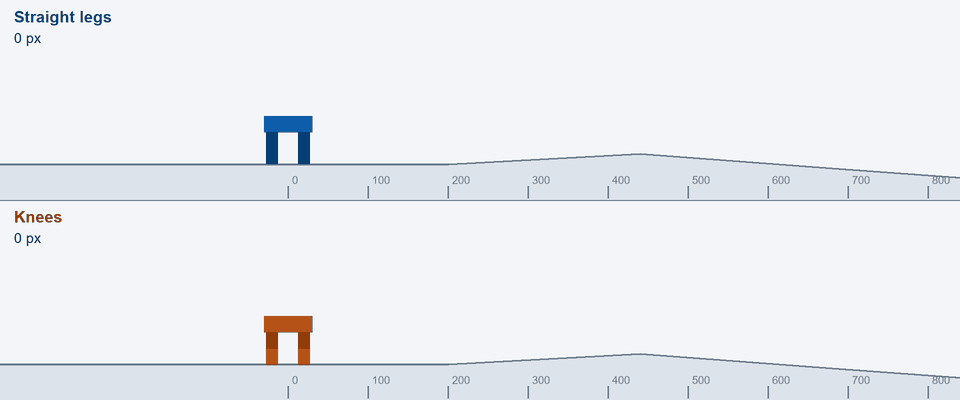
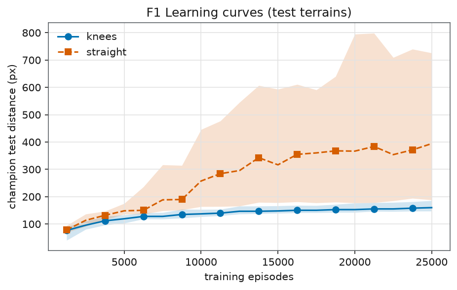
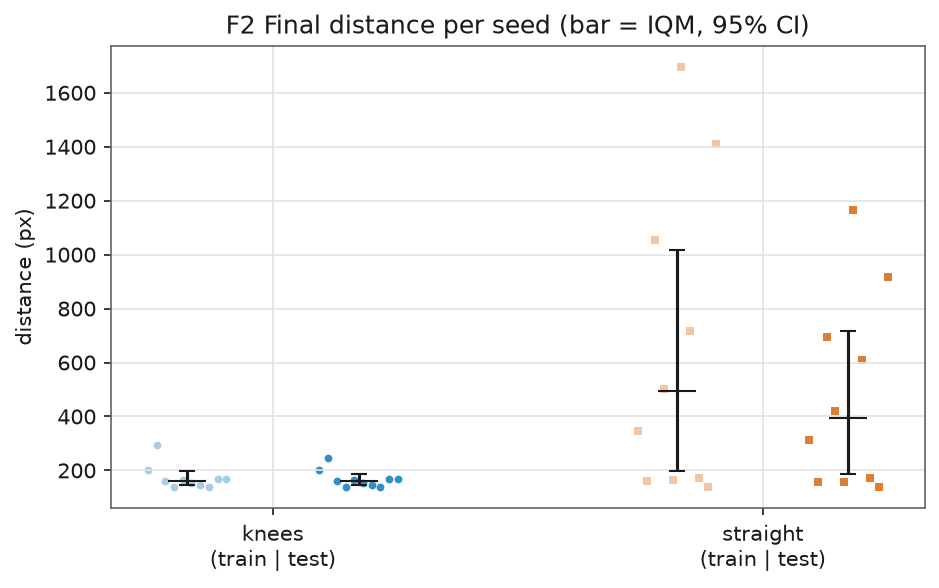
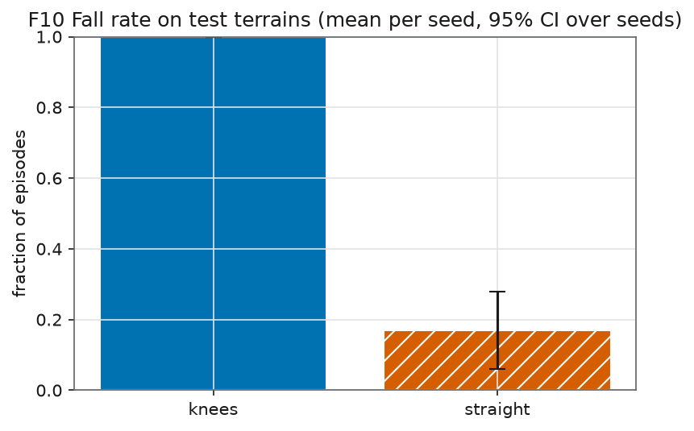
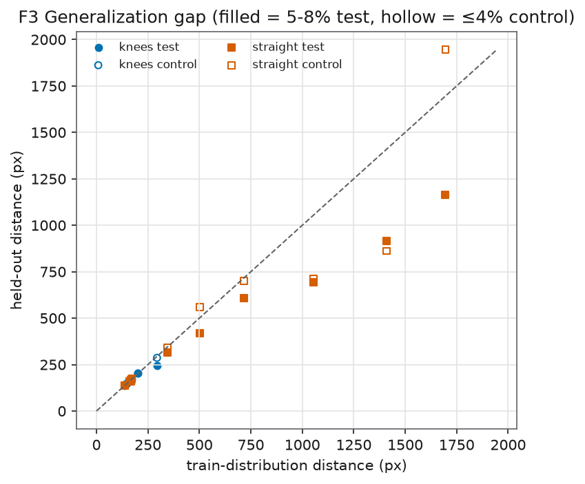
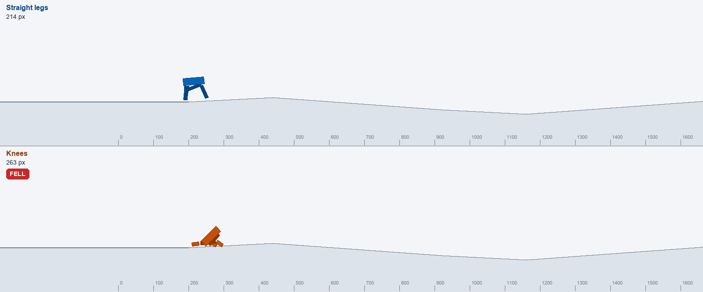
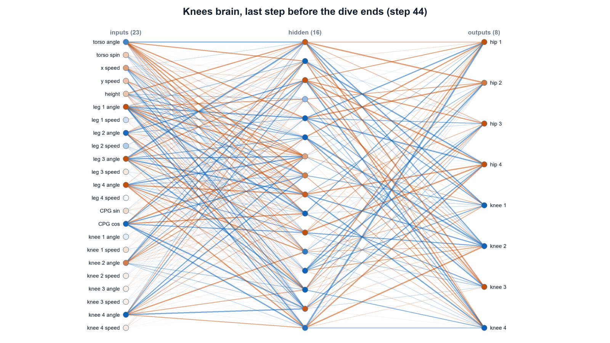

# I gave my walking robot knees. It learned to fall forward instead.

<!--
Alternative titles:
- Knees made my evolved robot worse, and that taught me more than a win would have
- My robot found a shortcut: the dive
-->


*Trained champions on a steep test course neither saw in training. Top: straight legs. Bottom: knees.*

I gave my simulated four-legged robot knees, expecting it to climb slopes better. Every single one of the ten kneed runs learned the same thing instead: throw the body forward, land on the torso, and fall.

**Result: 0 of 10 kneed walkers made it through a single test course without falling. Here's why, and what it taught me about reward design.**

This is Part 1 of 2. It is the story of an experiment that failed, why it failed, and what I got wrong while trying to find out.

## A 324-weight brain, evolved instead of trained

Evolution-1 is a small research project. A 2D four-legged creature lives in a physics simulation built with Pymunk. Its brain is a neural network with 324 weights, and I train it with a genetic algorithm.

A genetic algorithm is evolution with the biology stripped out. There is no backpropagation. I make a population of creatures with random brains, score each one on a course, keep the best, breed them, mutate the offspring a little, and repeat. The score is simple: reward going right, punish falling over.

The goal is not a clever robot. It is to understand, one change at a time, what makes evolved creatures work. Each change gets its own experiment, with a prediction written down before I run it.

## Why knees: Sims' strength rule

I had been reading Karl Sims' "Evolving Virtual Creatures" (SIGGRAPH 1994). In it, creatures are jointed bodies and every joint has its own muscle. Strength scales with the thickness of the parts a joint connects (section 3.3).

My creature's legs were the opposite of that: each one a single stiff 40 px stick with one motor at the hip. A stick like that cannot lift its foot over a rise. On slopes it scrapes along the ground. A knee should let the foot fold up and clear it.

## What I built: thigh, shin, and a one-way knee

Each leg became a 20 px thigh and a 20 px shin, joined by a knee. Total leg length and mass stayed the same, so standing height did not change. The knee is one-way: it bends only in one direction, with a limit at 90 degrees.

The knee motor gets half the hip's force. That follows Sims' cross-section rule, since the hip joins a thick torso and the knee joins two thinner parts.

The brain had to grow too. It now senses each knee, so inputs went from 15 to 23. It drives four more motors, so outputs went from 4 to 8. The weight count went from 324 to 520. I also checked that the old creature behaves byte-for-byte the same when knees are switched off, so the comparison starts from an unchanged baseline.

## A fair test: 10 seeds and held-out courses

I did not want to fool myself, so the setup was strict.

- 10 seeds for each body, so one lucky run cannot decide anything.
- The same training budget: 25,000 episodes per run.
- Training on random gentle courses, with slopes up to 4%.
- The champion of each run is picked on separate validation courses, not the training ones.
- The final score comes from held-out courses: steeper 5 to 8% slopes that neither body ever saw during training. Held-out just means the creature never got to practice on them.

Before any training I wrote down two predictions. H6: knees go further. H7: knees fall less.

Training ran on my laptop, 34 core-hours in total. At one point the machine hit 87 degrees C, so I throttled the job to 4 cores and waited.

## The results: knees fell on every test course

I report the interquartile mean (IQM) across seeds. That is the average after throwing away the best and worst quarter of runs, which makes it harder for one odd seed to swing the number. Brackets are 95% confidence intervals.

| Metric (test courses) | Straight legs | Knees |
|---|---|---|
| Distance (IQM) | 394 px [190, 718] | 160 px [148, 187] |
| Fall rate | 17% | 100% |
| Seeds that reached 300 px | 6 of 10 | 0 of 10 |

Every kneed champion fell on every test course.

H6, knees go further: inconclusive. The direction is against knees, but the p-value is 0.054, just over my 0.05 line, so I do not claim a proven loss. H7, knees fall less: not supported. The opposite happened, with p = 0.0001.


*Learning curves on the test courses. Straight legs keep climbing, knees flatten out early.*


*Final test distance, one dot per seed.*


*Fall rate per variant. The kneed walkers fall every time.*


*Train distance against test distance. The kneed gap is zero, which here is not a good sign: they fall just as fast on easy courses.*


*Step 44: the kneed walker's torso touches the ground and the episode ends as a fall. The straight walker reached 1,582 px on this course.*

## What the kneed walkers learned: the dive pays

When I replayed the champions, I saw a dive. They lunge forward 160 to 260 px in 30 to 45 steps, then the torso hits the ground and the episode ends.

Looking at the reward, this is not stupid. Reward is 2 times distance, and a fall costs 100.

```python
reward = 2 * (torso_x_now - torso_x_before)   # every physics step
if fell:
    total_reward -= 100                        # once, at the end
```

A 200 px dive in about 35 steps earns about +400 - 100 = +300. That beats a clumsy early walker, who has not yet learned to walk far.

Evolution found that shortcut and stopped climbing. Median best training score at 20, 40, 60, 80 and 100% of the budget:

| Budget used | 20% | 40% | 60% | 80% | 100% |
|---|---|---|---|---|---|
| Straight | 246 | 427 | 516 | 594 | 782 |
| Knees | 112 | 153 | 182 | 172 | 174 |

The kneed score is flat from about 60% of the budget. The straight walkers could not dive that far with stiff legs, so they were pushed toward real walking.


*The knees brain at its last step. Orange is positive, blue negative; bright lines are the connections doing the work.*

## Looking at what ended each run

The diving story was a good one, but I did not trust it yet. The score told me the walkers were worse. It did not tell me why they were ending. So I checked what actually ended each episode.

My first guess was that they were tipping over. They were not. Tilt was small, between 0.07 and 0.78 radians. The body was mostly level.

What was happening: the torso was touching the ground while the body was level, and my fall rule treats any torso contact as death. A bent knee lowers the torso. So using the knee at all risks an instant "fall", even when the creature is upright and fine.

Then I found a second problem, and this one was my bug. The knees were bending to 116 to 128 degrees, past their 90 degree limit. The motor could swing a knee about 28 degrees in a single physics step. The limit joint only pushes back after the knee is already past the limit, so the motor just outran it. Step 1 had a physics bug in it, and some of what I measured was the bug.

There was one more detail I liked. When the knee bends, the foot folds forward under the body, a bit like Boston Dynamics' Spot. The idea works. My setup just did not let it.

## What I take from this: the reward is the spec

The reward is the real spec. Sims warns about this in section 5.2: creatures can gain speed by simply falling over. My reward allowed exactly that. Evolution does what you score, not what you meant.

Measure what ends the episode, not just the score. The score said "worse". Only looking at tilt and contacts said "wrong rule, broken limit".

A failed experiment with honest predictions still teaches more than a tuned success. If I had tweaked knee strength until a number went up, I would never have found the fall rule.

## What's next: fix the rule, the limit, the body

Part 2 fixes the three things above.

- The fall rule becomes a penalty instead of instant death: minus 2 per step while the torso touches the ground.
- The knee limit gets fixed so the motor cannot blow through it.
- A third body, inspired by the real joint limits of Spot. Spot's knees go from about 14 to 160 degrees, and it sits with its body 191 mm off the floor. Mine will have knees from 14 to 150 degrees, standing slightly bent.

Training also moves off my laptop. GitHub Actions will run 30 cloud machines in parallel, instead of one overheating laptop.

## How I built this

I designed the experiments, chose what to test from the papers I read, and made the calls on fairness and what counts as a result. AI coding agents (Claude) wrote most of the code from my plans; I reviewed the changes, and every run was checked with automated tests and a byte-for-byte check that the old creature didn't change. The mistakes in this post, including the knee bug, are mine to own.

## Code and data

Repo: [github.com/000wahab000/Evolution](https://github.com/000wahab000/Evolution). Experiment config: `experiments/exp3_knees.json`.
Full write-up: `docs/evolving-virtual-creatures/01-knees/results.md`.
