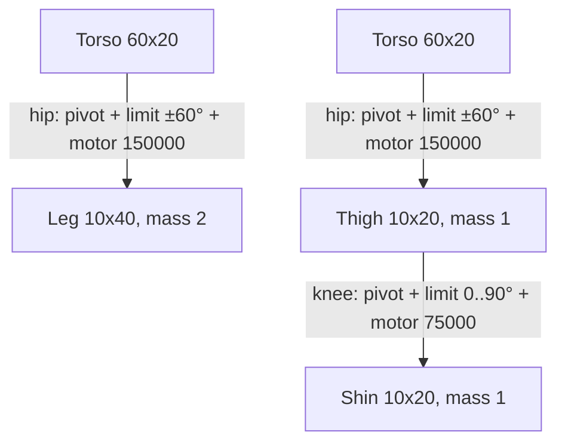
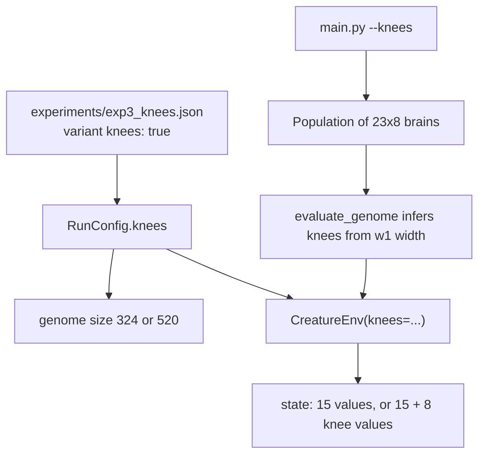

# Optional Knees for the Quadruped - Plan

## Goal Capsule

- **Objective:** You can show, with fair before/after numbers, whether giving the walker knees lets it travel further and fall less on slopes it never trained on, and those numbers are documented well enough to go straight into a blog post or report.
- **Means:** an opt-in `knees` setting that splits each leg into thigh + shin with a one-way powered knee (KTD1-KTD4), compared against today's straight legs through the existing research runner (KTD6).
- **Authority:** Product Contract R-IDs win on behavior; KTDs win on mechanism; units override neither.
- **Stop conditions:** stop and report if turning `knees` off changes any number the straight-legged creature produced before this work (R2); stop before training (U6) until the user has read the technical walkthrough and says go.
- **Execution profile:** U1-U5 are coded by Haiku 5.5 subagents, one unit per agent, on the `feat/knees` branch in the main checkout (never a git worktree). The orchestrating session records the pre-change fingerprint, reviews each agent's diff, runs the Verification Contract, then hands the user a detailed technical walkthrough and waits before U6. (session-settled: user-directed — chosen over the orchestrating model writing the code: the plan is detailed enough for simpler coders.)
- **Who finishes:** Haiku agents write U1-U5; the orchestrating session verifies, writes the walkthrough, and runs U6 training; the user reviews, adds screenshots, and decides on merging the PR.

---

## Product Contract

### Summary

Add knees as an option the straight-legged walker can be built with, leaving today's creature untouched when the option is off. Train both creatures under identical conditions and publish the comparison in `docs/evolving-virtual-creatures/01-knees/` as an abstract, a results write-up, and chart images.

### Problem Frame

Each leg today is one rigid 40 px stick driven by one hip motor (`src/environment.py`, `CreatureEnv.create_creature`). A stiff stick cannot lift its foot over a rise, so on slopes the creature can only swing and scrape. An evaluation on 2026-10-25 showed the saved best model falls on 5 of 6 unseen random courses, mostly on climbs. Sims (1994, "Evolving Virtual Creatures", sec. 2-3) builds creatures from jointed parts whose joints each carry their own effector; a knee is the smallest step in that direction for this project. The user is writing up the project, so every change must also leave behind documentation they can publish.

### Requirements

**Body**
- R1. With knees enabled, each of the four legs is a thigh and a shin joined by a knee that bends one way only, through roughly 0 to 90 degrees, and has its own motor.
- R2. With knees disabled (the default), the creature, its sensors, its rewards, and every existing training and evaluation path behave exactly as before this work.
- R3. The knee motor is weaker than the hip motor, following Sims' rule that joint strength scales with the size of the parts the joint connects.

**Brain and models**
- R4. A kneed creature's brain also senses each knee's angle and speed and drives each knee motor: 23 inputs and 8 outputs instead of 15 and 4.
- R5. A model trained with knees can never be loaded into the straight-legged body, or the reverse, and existing saved models keep working as straight-legged models.
- R6. Training with knees from the command line never overwrites the models the dashboard serves from `data/models/`.

**Comparison and documentation**
- R7. Straight and kneed creatures are compared by training both from scratch with the same seeds, budget, and random training courses, then scoring each run's champion on steeper held-out courses neither saw.
- R8. `docs/evolving-virtual-creatures/` holds a README naming the paper and listing the planned steps, and `01-knees/` holds `abstract.md`, `results.md`, and a `screenshots/` folder of chart images.
- R9. `results.md` reports the outcome plainly whichever creature wins, including any tuning done along the way.

### Key Decisions

- **Knees are an option beside the old body, not a replacement.** Governs R2, R5. (session-settled: user-approved — chosen over replacing the straight legs: old models, replays, and the dashboard keep working, and the comparison has a baseline.)
- **One paper idea per PR, in the order knees, contact sensors, multi-course scoring, settle-before-scoring, dashboard.** Governs R8. (session-settled: user-directed — chosen over bundling ideas: each change gets its own measurable before/after.)
- **Every step ships a folder with abstract, results, and screenshots under a folder named after the paper.** Governs R8, R9. (session-settled: user-directed — chosen over a single plan file in `docs/plans/`: the user publishes these.)
- **Training waits until the user has read a detailed technical walkthrough.** (session-settled: user-directed — chosen over training straight after implementation.)

### Success Criteria

- The comparison table in `results.md` can be read by someone who has not seen the code, and states which creature went further and fell less on held-out courses, with seeds and budget named.
- A reader of `abstract.md` understands what a knee changes and why the test is fair without reading code.

### Scope Boundaries

- The dashboard, 3D view, replay JSON files, and `get_render_state` are unchanged; a kneed creature is not drawn in the browser in this PR.
- Body shape is not evolved; thigh and shin lengths are fixed.
- Foot contact sensors, multi-course fitness on the main training path, and settle-before-scoring are separate later steps.
- The CMA-ES / OpenAI-ES optimizers are not compared here; the experiment uses the GA like experiment 1.
- Considered and not built: a stored `knees` flag inside `.npz` files. The brain's input width already identifies the body unambiguously (KTD5), so a second source of truth could only disagree with it. Would change if a future body had the same input width as another.

#### Deferred to Follow-Up Work

- Drawing kneed creatures in the dashboard and recording kneed replays (dashboard step).
- Foot contact sensors (`02-contact-sensors/`).

---

## Planning Contract

### Key Technical Decisions

- KTD1. **Same total leg length, split in half.** Thigh and shin are each 20 px long, 10 px wide, mass 1 (today: one 40 px, mass 2 leg). Standing height, total mass, and hip placement stay the same, so any difference in results comes from the joint, not from a taller or heavier body.
- KTD2. **One-way knee via a rotary limit of 0 to pi/2, bending so the foot swings backward.** Mirrors the hip's `RotaryLimitJoint` pattern. The sign that makes the foot go backward in Pymunk's y-down frame is confirmed by a test, not assumed.
- KTD3. **Knee motor max force 75000, half the hip's 150000.** Sims (sec. 3.3) gives each effector a strength proportional to the larger cross-section of the two parts it joins. In 2D the cross-section is the part's thickness: the hip joins the torso (20 px) to the thigh (10 px), the knee joins two 10 px parts, so the knee gets half. Motor rate uses the same `action * 10` mapping as the hip. This is the one number allowed to be tuned; any change is recorded in `results.md` (R9).
- KTD4. **Knee sensors are appended after the existing 15 inputs.** Indices 0-14 keep their meaning; 15-22 hold each knee's relative angle and angular velocity × 0.1 (same scaling as the hips). Outputs 0-3 stay hip motors, 4-7 are knee motors. `self.legs` keeps meaning the thighs, so every consumer of hip angles (gait analysis, replays) is unaffected.
- KTD5. **The body is inferred from the brain's shape.** A state dict whose `w1` has 23 columns is kneed, 15 is straight. Loading a model builds the matching body, so a mismatch is impossible rather than checked, and old files need no migration (R5).
- KTD6. **The comparison runs through the research runner as a new experiment, not through `main.py`.** `src/research/` already trains per seed on random courses, keeps held-out validation/test/control sets, and produces statistics, figures F1-F10, and `REPORT.md`. `main.py` trains on one fixed course, which is the overfitting this comparison must avoid. `RunConfig` gains `knees: bool = False`.
- KTD7. **Old run hashes do not change.** `RunConfig.sha256()` leaves the `knees` key out when it is false. Otherwise every existing results folder (including Colab runs on Google Drive) would be refused as stale.
- KTD8. **Genome size comes from the run config.** `evaluate.py` keeps `DIM` (324) for the straight body and gains a per-config dimension (520 for knees); `from_flat` picks the shape set by vector length. `src/research/playground.py` keeps using `DIM` unchanged.
- KTD9. **`main.py --knees` writes to `data/models/knees/`.** The dashboard and `scripts/record_replay.py` keep reading `data/models/` untouched (R6).

### High-Level Technical Design

One leg, before and after (knees enabled):



How the `knees` setting flows through the system:



Brain shape by body:

| Body | Inputs | Hidden | Outputs | Weights |
|---|---|---|---|---|
| Straight (default) | 15 | 16 | 4 | 324 |
| Kneed | 23 | 16 | 8 | 520 |

---

## Output Structure

```text
docs/evolving-virtual-creatures/
  README.md
  01-knees/
    plan.md
    abstract.md
    results.md            (written after training, U6)
    screenshots/          (F1-F10 charts copied from the analysis, plus the user's own)
experiments/exp3_knees.json
tests/test_knees_env.py
tests/test_knees_research.py
tests/test_knees_cli.py
```

---

## Implementation Units

### U1. Kneed body in the environment

- **Goal:** `CreatureEnv(knees=True)` builds, resets, steps, and senses a thigh + shin creature; `knees=False` is byte-for-byte today's creature.
- **Requirements:** R1, R2, R3, R4; KTD1-KTD4.
- **Dependencies:** none.
- **Files:** `src/environment.py`, `tests/test_knees_env.py`.
- **Approach:**
  1. Add a `knees` constructor argument (default `False`) stored on the env.
  2. In `create_creature`, when kneed, build each leg as thigh + shin per KTD1, add the knee pivot, limit (KTD2), and motor (KTD3); keep thighs in `self.legs`, shins in a new list, knee motors after hip motors in `self.motors`.
  3. In `reset`, place each shin directly below its thigh; `pose_noise` still rotates the hip only, with the shin following the thigh rigidly.
  4. `step` already zips actions with motors, so 8 actions drive 8 motors.
  5. In `get_state`, append the 8 knee values per KTD4 when kneed.
- **Execution note:** before editing, record a fingerprint of today's behavior on this machine (an episode of `data/models/best_model.npz` on the legacy course and on one random course, plus a short `run_one` history) and compare it after U1 and after U2. R2 is met only if they match exactly.
- **Patterns to follow:** the existing hip construction loop (`PivotJoint` + `RotaryLimitJoint` + `SimpleMotor`, `ShapeFilter(group=1)`).
- **Test scenarios:**
  - Default env returns a 15-value state, 4 legs, 4 motors.
  - Kneed env returns a 23-value state, 4 thighs, 4 shins, 8 motors, and knee angles read 0 after reset.
  - Kneed env with a constant positive knee action for 30 steps bends each knee within [0, pi/2] and moves each foot backward relative to its knee (pins KTD2's sign).
  - Kneed env with zero actions for 30 steps stands without falling (legs act as stiff sticks, like today).
  - Kneed env reset with `pose_noise` rotates thighs by the given angles and leaves knee angles at 0.
  - A kneed episode with a random 23x8 brain runs to completion through `run_episode` with no exception.
- **Verification:** new tests pass, the full existing suite passes, the pre-change fingerprint matches.

### U2. Research runner support for knees

- **Goal:** an experiment variant with `"knees": true` trains and evaluates kneed creatures end to end; straight runs and their hashes are unchanged.
- **Requirements:** R2, R5, R7; KTD6-KTD8.
- **Dependencies:** U1.
- **Files:** `src/research/config.py`, `src/research/evaluate.py`, `src/research/runner.py`, `tests/test_knees_research.py`.
- **Approach:**
  1. Add `knees: bool = False` to `RunConfig`; exclude it from `sha256()` when false (KTD7).
  2. In `evaluate.py`, add the kneed shape set and a per-config dimension; make `from_flat` pick shapes by vector length; pass `knees=cfg.knees` in `make_env` (KTD8).
  3. In `runner.py`, size the optimizer with the per-config dimension instead of `DIM`.
- **Patterns to follow:** existing `brain_input` variant plumbing through `RunConfig` and `make_env`.
- **Test scenarios:**
  - A straight `RunConfig` has the same `sha256()` as before this change (compare against the hash computed from a dict without the key).
  - A `knees: true` RunConfig has a different hash from the straight one.
  - `to_flat`/`from_flat` round-trip a 520-weight kneed genome with shapes (16, 23), (16,), (8, 16), (8,).
  - `run_one` on a tiny kneed config finishes, writes `champion.npz` with `w1` of shape (16, 23), and is deterministic across two runs with the same seed.
  - An experiment file with an unknown key next to `knees` is still rejected.
- **Verification:** new tests pass, existing research tests pass, fingerprint still matches.

### U3. Command-line training and rendering with knees

- **Goal:** `python main.py --train --knees` and `python main.py --render --knees` work without touching dashboard models.
- **Requirements:** R5, R6; KTD5, KTD9.
- **Dependencies:** U1.
- **Files:** `main.py`, `src/evolution.py`, `tests/test_knees_cli.py`.
- **Approach:**
  1. `evaluate_genome` in `src/evolution.py` infers knees from the state dict's `w1` width and builds the matching env (KTD5).
  2. `train` takes a `knees` flag, builds the population with 23x8 brains when set, and writes all model and log files under `data/models/knees/` (KTD9).
  3. `render` takes the same flag, reads from the kneed folder, and builds kneed envs.
  4. Add `--knees` to the argument parser.
- **Patterns to follow:** existing `train`/`render` structure and `MODELS_DIR` constants in `src/utils.py`.
- **Test scenarios:**
  - `evaluate_genome` with a 23x8 state dict runs a kneed episode; with a 15x4 state dict, a straight one.
  - `Population` built for knees produces children whose `w1` is (16, 23) after crossover and mutation.
  - `train(generations=1, pop_size=4, knees=True, workers=1)` run inside a temp working directory writes `data/models/knees/best_model.npz` and does not create or modify `data/models/best_model.npz`.
- **Verification:** tests pass; a manual 3-generation `--train --knees` run completes.

### U4. Pre-registered knees experiment

- **Goal:** the comparison is defined in a config file and its hypotheses are written down before any training.
- **Requirements:** R7; KTD6.
- **Dependencies:** U2.
- **Files:** `experiments/exp3_knees.json`, `experiments/HYPOTHESES.md`.
- **Approach:** mirror `exp1_cpg.json`: GA, pop 50, `episodes_budget` 25000, `rollouts_k` 5, default terrain splits. Two variants, `straight` ({}) and `knees` ({"knees": true}). Seed count is set at U6 from measured throughput (see Open Questions). Hypotheses: H6, knees > straight on held-out test distance; H7, knees < straight on test fall rate. Add an "Experiment 3, knees" section to `HYPOTHESES.md` with both.
- **Test expectation:** none -- configuration only; U2's tests prove the runner accepts the `knees` key, and `ExperimentConfig.load` on the file is exercised in U6's smoke run.
- **Verification:** the file loads with `ExperimentConfig.load`, and a one-seed smoke run of both variants completes.

### U5. Documentation folder and abstract

- **Goal:** the paper-named docs folder exists with a README and the knees abstract, ready for results.
- **Requirements:** R8.
- **Dependencies:** none.
- **Files:** `docs/evolving-virtual-creatures/README.md`, `docs/evolving-virtual-creatures/01-knees/abstract.md`.
- **Approach:** README: paper citation (Karl Sims, "Evolving Virtual Creatures", SIGGRAPH 1994), a two-paragraph plain summary, the ordered roadmap with one line per step and its paper section, and links to each step folder. Abstract: what a knee is in this simulation, why it might help on slopes, how the test is kept fair, and what result would count as knees helping. Plain language for a blog reader; no code.
- **Test expectation:** none -- documentation.
- **Verification:** a reader with no code context can say what is being tested and how, from `abstract.md` alone.

### U6. Train, analyze, and publish results (after user approval)

- **Goal:** both variants trained, analyzed, and written up with charts.
- **Requirements:** R7, R8, R9.
- **Dependencies:** U1-U5 and the user's go-ahead.
- **Files:** `docs/evolving-virtual-creatures/01-knees/results.md`, `docs/evolving-virtual-creatures/01-knees/screenshots/*.png`.
- **Approach:**
  1. Measure episodes per second for each variant on a one-seed smoke run, then fix the seed count so the full run fits the time the user accepts.
  2. Run `scripts/run_experiment.py experiments/exp3_knees.json`, then `scripts/verify_results.py` and `scripts/analyze.py`.
  3. Copy the light-theme PNG figures F1-F10 into `screenshots/` with readable names.
  4. Write `results.md`: setup (seeds, budget, courses), a headline table (test distance IQM with CI, fall rate, train-vs-test gap for each variant), H6/H7 verdicts, what the charts show, and any knee-strength tuning done.
  5. Publish a results page (artifact) with the same tables and charts for screenshots.
- **Test expectation:** none -- experiment execution; correctness is covered by `verify_results.py`.
- **Verification:** `verify_results.py` reports no problems; every number in `results.md` traces to `results/exp3_knees/summary/summary.json`.

---

## Open Questions

### Deferred to implementation

- Seed count for the full run (10 is the target). It depends on measured kneed throughput: more bodies and joints slow each step, and 8 cores must fit the run into an acceptable wall time.
- Exact sign convention for the knee limit and motor (KTD2), settled by the U1 foot-direction test.

---

## Verification Contract

| Check | Command | Proves |
|---|---|---|
| Full suite | `python -m pytest -q` | nothing existing broke |
| Knees tests | `python -m pytest -q tests/test_knees_env.py tests/test_knees_research.py tests/test_knees_cli.py` | U1-U3 behavior |
| Straight-body fingerprint | the scratch fingerprint script, before and after | R2: identical numbers |
| Lint | `ruff check src tests main.py` | repo style (ruff is configured in `pyproject.toml`) |
| Experiment integrity | `python scripts/verify_results.py results/exp3_knees` | U6 runs complete and not stale |

---

## Definition of Done

- U1-U5: all checks in the Verification Contract pass except experiment integrity; the fingerprint matches; the user has received the technical walkthrough.
- U6: results written, charts in `screenshots/`, results page published, every number traceable to `summary.json`.
- No leftover experimental code, debug prints, or abandoned approaches in the diff.
