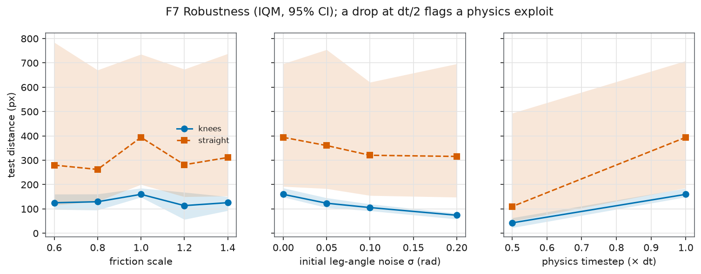
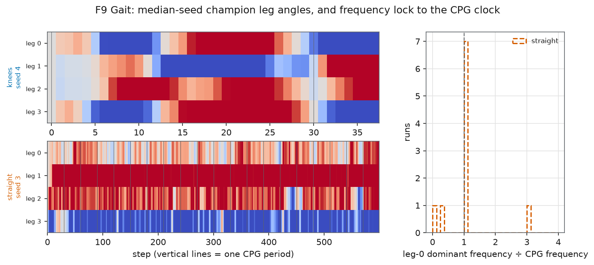
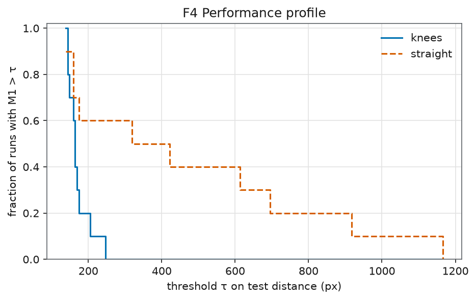
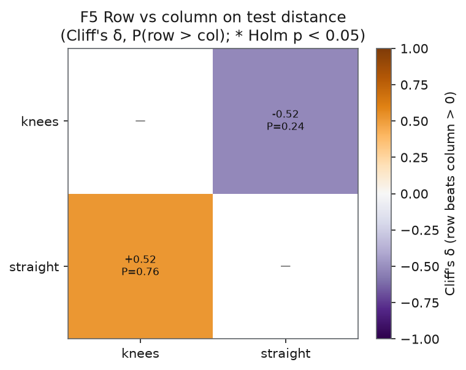
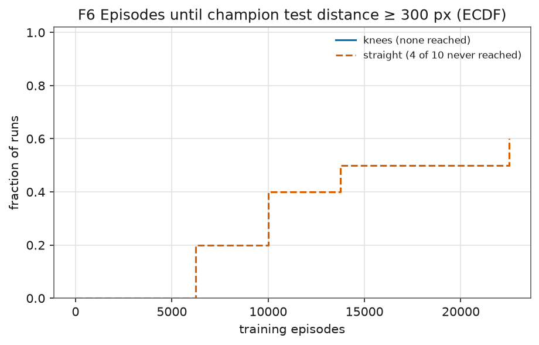
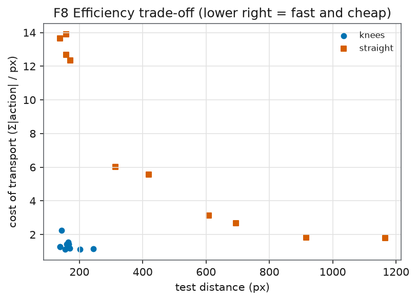

# Step 1 — Knees: results

**TL;DR.** Knees did worse. The kneed walkers learned to dive: they lunge forward, land on their torso, and the episode ends as a fall. On the unseen steep courses every kneed champion fell on every course. Our distance hypothesis (H6) is inconclusive, leaning against knees. Our fall hypothesis (H7) is clearly not supported. The useful lesson is about the reward, not the knee. The reward lets a fast fall beat a slow walk.

## Setup

- Two variants. Straight: today's one-piece legs. Knees: thigh plus shin, with a one-way powered knee at half the hip's strength.
- 10 seeds each (0-9).
- Genetic algorithm, population 50, 25,000 training episodes per run.
- Each genome is scored on 5 random training courses (slopes up to 4%, friction x0.9-1.1, small starting-pose noise).
- The champion is picked on separate validation courses.
- The final score comes from 10 held-out test courses with steeper 5-8% slopes, never seen in training.
- Hypotheses H6 and H7 were written down in `experiments/HYPOTHESES.md` before training.
- Statistics: interquartile mean (IQM) across seeds with a 95% bootstrap confidence interval, and Mann-Whitney U tests with Holm correction.
- Trained locally on an Intel Windows laptop. 34.3 core-hours in total.

## Headline numbers

Test courses. IQM with 95% CI in brackets.

| Metric | Straight | Knees |
|---|---|---|
| Distance | 394.2 px [190.4, 718.3] | 160.0 px [148.0, 187.0] |
| Fall rate | 0.17 [0.06, 0.28] | 1.00 [1.00, 1.00] |
| Train-test gap | 98.6 px | 0.0 px |
| Seeds that reached 300 px on test during training | 6 of 10 (median 10,000 episodes) | 0 of 10 |

Every kneed champion fell on every test course. The train-test gap of zero is not a good sign here. Knees fall just as fast on easy training-like courses, so there is nothing to lose on harder ones.

## Hypothesis verdicts

| ID | Prediction | Result | Verdict |
|---|---|---|---|
| H6 | Knees go further on test courses | IQM difference -234.2 px [-556.4, -29.7], Holm p = 0.054, Cliff's delta = -0.52 | Inconclusive |
| H7 | Knees fall less | Opposite: difference +0.8 [+0.7, +1.0], Holm p = 0.0001, Cliff's delta = +1.00 | Not supported |

"Inconclusive" here means the direction is against knees, but the test just misses the 0.05 cut-off, so we do not claim a proven loss.

## What the kneed walkers actually learned

We replayed champions on the test courses. They learned a dive. They lunge forward 160-260 px in about 30-45 steps (roughly 1.5-2 seconds of simulated time). Then the torso hits the ground and the episode ends as a fall.

- Seed 0: 33 steps and 202 px on all 10 courses.
- Seed 1: 35-44 steps and 222-263 px.
- Seed 2: 31 steps and 161 px.

Why this pays: the reward is 2 times forward movement, and a fall costs -100. A 200 px dive scores about +300. That beats a slow early walker. Straight walkers cannot dive as far, so they were pushed toward real walking.

The learning curves agree. Kneed training scores levelled off early. Straight scores kept climbing. Median best training score at 20/40/60/80/100% of the budget:

| Budget used | 20% | 40% | 60% | 80% | 100% |
|---|---|---|---|---|---|
| Straight | 246 | 427 | 516 | 594 | 782 |
| Knees | 112 | 153 | 182 | 172 | 174 |

Kneed median test distance did creep up from 154 to 162 px over the last 20% of training. It is technically still rising. That is one more reason H6 is labelled inconclusive rather than "knees lose". But the 100% fall rate suggests more budget alone is unlikely to fix the dive.

## Why (our interpretation, not proven)

1. A bent knee lowers the torso, and a fall is declared when the torso touches the ground. So any real use of the knee risks an instant "fall".
2. Diving is an easy local optimum that the reward allows.
3. Knee motors spin at up to 10 rad/s and hit their limit almost at once, so early random brains collapse. Random kneed brains fell after about 92 steps on average, against about 343 for straight.

This is what Sims warns about in section 5.2 of his paper: creatures "generating high velocities by simply falling over". He lets each creature settle before scoring. That is step 4 of our roadmap, and this result is a reason to do it, possibly earlier.

## Charts


F1. Learning curves on test courses. Shaded area is the 95% CI.


F2. Final test distance. One dot per seed.


F3. Train distance against test distance. Points below the diagonal overfit.


F10. Fall rate per variant.


F7. Robustness to friction and pose changes, and to a halved physics timestep.


F9. Gait frequency against the rhythm clock.


F4. Share of seeds beating each distance.


F5. Effect-size matrix.


F6. Cost of transport.


F8. Speed against energy.

## Caveats

- Physics-exploit flag. The analysis replays each champion with the physics timestep halved. If distance drops by more than 30%, it flags a possible exploit of the simulator. Knees were flagged on 10 of 10 seeds and straight on 8 of 10 (IQM drop +73% for knees, +72% for straight). Both bodies partly rely on simulator-specific behaviour, so treat absolute distances with care. Sims warns about this in section 4: evolution finds simulator bugs.
- One laptop, one CPU type.
- 10 seeds per variant.
- Knee strength was not tuned. It stayed at the pre-registered 75,000.
- All knees bend the same way.
- Knee limits leaked: the knee motor could push a knee up to ~30° past either stop within a single physics step, so step-1 knees could bend to ~120° and over-straighten. Fixed in step 2 (knees v2); step-1 kneed results include this bug.

## What's next

- Let each creature settle before scoring, and/or use a fall rule that does not punish a lowered torso. Then re-test knees.
- Add contact sensors.

## Reproduce

```
python scripts/run_experiment.py experiments/exp3_knees.json --workers 4
python scripts/verify_results.py results/exp3_knees
python scripts/analyze.py results/exp3_knees
```
