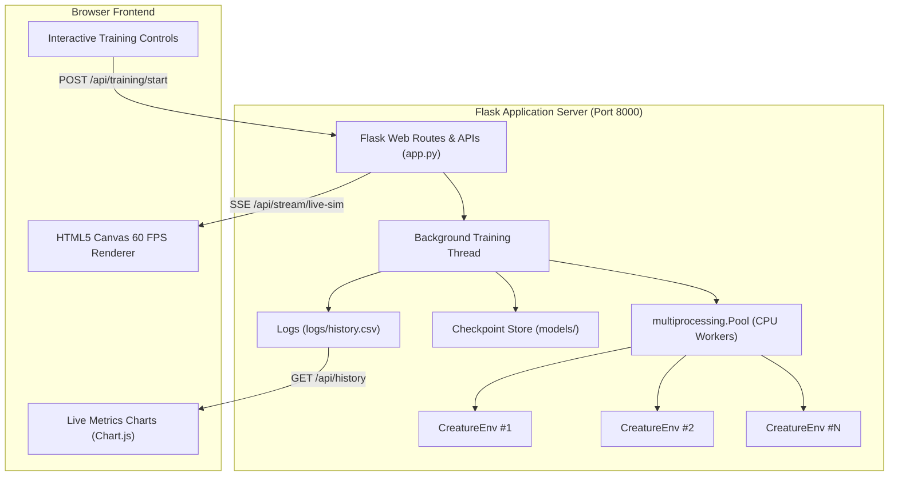

# v2 Training Optimization and Deployment - Plan

## Goal Capsule

- **Objective:** Scale evolutionary simulation throughput across multi-core CPUs and deliver an interactive web deployment with real-time HTML5 Canvas creature rendering and live training controls.
- **Means:** Multi-process worker pool evaluation and Flask SSE telemetry streaming to client-side Canvas (KTD1, KTD2).
- **Product Authority:** `Evolution-1` v2 milestone (optimizing training and deployments); surrounding roadmap milestones (v3 terrain, v4 horse rider, v5/v6 combat) are explicitly out of scope.
- **Open Blockers:** None.

---

## Product Contract

### Summary
Accelerate evolutionary simulation rollouts using Python multiprocessing and provide an interactive web dashboard with real-time HTML5 Canvas physics visualization, live training metrics, and one-click containerized deployment.

<!-- ce-section: work-relationships -->
### How This Work Fits Together
This plan owns **v2: Training Optimization and Deployment**, which is the operational foundation for the project roadmap:
- Enables `v3: Procedural Terrains & Obstacles` — fast parallel evaluation is required to train robust creatures across procedurally varied hills and hazard pits.
- Enables `v4: Horse Morphology & Human Rider` — high-throughput simulation is critical when scaling from 4-leg dog to multi-segment rider bodies.
- Enables `v5-v6: Combat & Multi-Agent Battles` — requires efficient real-time visualization and distributed agent rollouts.

### Problem Frame
The current v1 implementation evaluates generations sequentially on a single CPU core, taking substantial time for long evolutionary runs. Furthermore, visualization is limited to a local PyGame window that cannot be viewed headlessly in containers, and the web app only serves static post-run CSV data without interactive simulation or live training controls.

### Key Decisions
- **Multiprocessing ProcessPool over Threading** (session-settled: user-directed — chosen over single-threaded sequential: provides true multi-core CPU parallelism bypassing the GIL, accelerating generation rollouts by 4x-8x). Governs R1, R2.
- **Client-Side HTML5 Canvas Rendering over Server Video/PyGame Streaming** (session-settled: user-directed — chosen over server-rendered video: server broadcasts lightweight joint/body coordinates via JSON/SSE while client renders 60 FPS physics headlessly). Governs R3, R4.
- **Interactive Web Training Controls** (session-settled: user-approved — chosen over CLI-only controls: enables starting, pausing, and tuning hyperparameters directly from the dashboard). Governs R5, R6.
- **Zero-Config Docker Deployment** (session-settled: user-approved — chosen over manual local Python setup: encapsulates all dependencies, Pymunk physics, and Flask web server into a single `docker compose up` command). Governs R7, R8.

### Requirements

#### Simulation & Training Optimization
- R1. The evolutionary training loop shall support parallel rollout evaluation using a multi-worker process pool across available CPU cores.
- R2. Parallel evaluation shall maintain deterministic population fitness tracking, elitism preservation, and all-time record saving (`models/universal_best.pth`).

#### Interactive Web Visualization & Telemetry
- R3. The web dashboard shall stream live simulation frame data (torso position, angle, leg segments, and ground baseline) via a lightweight SSE/JSON endpoint.
- R4. The web dashboard frontend shall render creature physics in real-time on an interactive HTML5 Canvas element with smooth 60 FPS animation.
- R5. The web interface shall display live updating training metric charts (best fitness, average fitness, diversity score, generations/second).
- R6. The web interface shall provide interactive training controls to trigger training runs, pause execution, and adjust population size and mutation rates.

#### Containerization & Deployment
- R7. The project shall provide a self-contained `Dockerfile` and `compose.yaml` configuration that starts the web application and headless simulation on port 8000.
- R8. The containerized deployment shall operate with no display/X11 requirements and persist logs and saved models to mounted volumes.

### Key Flows
- F1. Parallel Generation Evaluation
  - **Trigger:** Training session launched from CLI or Web UI with $N$ population and $K$ workers.
  - **Actors:** Training Engine, Worker Pool, Environment Instances.
  - **Steps:** Master splits population into chunks; worker processes instantiate headless `CreatureEnv` instances; rollouts execute concurrently; rewards and final state metrics return to master; master sorts fitnesses, saves elites, and triggers evolution.
  - **Covered by:** R1, R2

- F2. Live Web Simulation Playback
  - **Trigger:** User opens web dashboard or clicks "Watch Live Creature".
  - **Actors:** Browser Canvas, Flask SSE Streamer, Active Model Evaluator.
  - **Steps:** Flask streams step telemetry $(x, y, \theta, \text{joints})$; browser Canvas updates camera to track leader; user can toggle between Best Model, Universal Best, or Live Population.
  - **Covered by:** R3, R4

### Acceptance Examples
- AE1. Multi-Core Scaling
  - **Covers:** R1
  - **Given:** A multi-core CPU machine and a population of 50 creatures.
  - **When:** `train()` is executed with `workers=4`.
  - **Then:** All 4 CPU cores are utilized and generation cycle time is reduced by at least 3x compared to sequential execution.

- AE2. Headless Browser Canvas Simulation
  - **Covers:** R3, R4, R7
  - **Given:** The application running inside a Docker container without a display server.
  - **When:** A user visits `http://localhost:8000`.
  - **Then:** The creature's torso and 4 oscillating legs render smoothly on the HTML5 Canvas in real-time.

- AE3. Live Hyperparameter Update
  - **Covers:** R6
  - **Given:** An active training session.
  - **When:** The user updates mutation rate to 0.25 via the web UI.
  - **Then:** Subsequent generations reflect the new mutation rate in logs and evolution behavior.

### Scope Boundaries
- **Deferred to v3:** Procedural terrain generation, uneven ground surfaces, stairs, and spike hazards.
- **Deferred to v4:** Morphological body restructuring, horse geometry, and human rider balance dynamics.
- **Deferred to v5/v6:** Spear weapons, visual perception sensors, and multi-creature battle mechanics.

### Success Criteria
- Generation throughput improves by at least 300% on multi-core hardware.
- Web dashboard delivers smooth real-time 60 FPS canvas visualization of creature movement.
- Full application runs out of the box with `docker compose up` without X11 or display errors.

---

## Planning Contract

### Key Technical Decisions
- KTD1. **Top-Level Pure Rollout Worker for Multiprocessing:** Python's `multiprocessing` requires picklable worker functions on Windows and POSIX. A standalone module-level function `evaluate_genome(state_dict, fitness_mode, max_steps)` will be created so that processes receive lightweight weight dictionaries and instantiate isolated `CreatureEnv` and `CreatureBrain` instances without IPC lock contention. (Governs R1, R2; session-settled: user-directed).
- KTD2. **Server-Sent Events (SSE) Telemetry Stream:** Flask will expose `/api/stream/live-sim` using generator streaming (`text/event-stream`). Telemetry packets contain torso center $(x, y, \theta)$, leg endpoints, current speed, and step count. (Governs R3, R4; session-settled: user-directed).
- KTD3. **HTML5 Canvas Double-Buffered Camera Engine:** Client-side JavaScript in `templates/index.html` will implement smooth linear interpolation (lerp) camera tracking anchored on the creature torso, rendering the ground line, distance tick markers, torso rectangle, and 4 leg limbs with distinct depths/colors. (Governs R4).
- KTD4. **Background Training Worker Thread in Flask:** Web-triggered training will run in a dedicated background `threading.Thread` with atomic status flags (`is_training`, `current_gen`, `paused`), broadcasting progress to `/api/training/status` and allowing dynamic live mutation updates. (Governs R5, R6).

### High-Level Technical Design

---

## Implementation Units

### U1. Multiprocessing Parallel Evaluation Engine
- **Goal:** Enable multi-core parallel rollouts for evolutionary training.
- **Requirements:** R1, R2.
- **Files:** `src/evolution.py`, `main.py`, `tests/test_parallel.py`.
- **Approach:**
  - Define top-level picklable `evaluate_creature(args)` worker in `src/evolution.py` or `src/evaluator.py`.
  - Update `Population.evaluate_parallel(pool, fitness_mode, max_steps)` to dispatch all population models across the process pool using `pool.map()`.
  - Add `--workers` flag to `main.py` (defaulting to CPU core count).
- **Test Scenarios:**
  - Verify that parallel evaluation produces identical fitness distributions to sequential evaluation for a fixed random seed.
  - Benchmark 50-creature generation evaluation time: verify $\ge 3\times$ speedup on multi-core systems.
- **Verification:** `pytest tests/test_parallel.py`

### U2. Headless Telemetry & Live Simulation SSE Streamer
- **Goal:** Stream live creature kinematics from server to browser without display server dependencies.
- **Requirements:** R3, R7, R8.
- **Files:** `src/environment.py`, `app.py`.
- **Approach:**
  - Add `get_render_state()` to `CreatureEnv` returning body coordinate dict: `torso`: `{x, y, angle, w, h}`, `legs`: `[{x, y, angle, w, h}]`, `ground_y`: 500, `stats`: `{velocity, reward, step}`.
  - Implement `/api/stream/sim` in `app.py` streaming JSON frames at 30-60 Hz using Python generators.
- **Test Scenarios:**
  - Connect to `/api/stream/sim` and verify incoming chunk format matches schema.
  - Verify generator gracefully handles client disconnection.
- **Verification:** Unit test streaming endpoint response headers and payload structure.

### U3. Interactive HTML5 Canvas Creature Visualizer & Web Dashboard
- **Goal:** Deliver an interactive, modern web interface with real-time physics rendering and live training telemetry.
- **Requirements:** R4, R5, R6.
- **Files:** `templates/index.html`.
- **Approach:**
  - Build HTML5 Canvas rendering loop with 2D context, camera tracking ($400 - \text{torso.x}$ translation), ruler ticks, and articulated creature limbs.
  - Integrate live Chart.js graphs for Best, Average, Worst Fitness and Population Diversity.
  - Add web control panel: "Start Training", "Pause", "Step Generation", and hyperparameter tuning sliders (Population Size, Mutation Rate).
- **Test Scenarios:**
  - Verify Canvas renders smooth animations on receipt of stream packets.
  - Verify clicking "Start Training" updates UI state and begins streaming live generation metrics.
- **Verification:** Browser validation of web UI layout and interaction.

### U4. Docker & Production Deployment Scaffolding
- **Goal:** Ensure zero-config containerized execution with mounted persistent volumes.
- **Requirements:** R7, R8.
- **Files:** `Dockerfile`, `compose.yaml`, `requirements.txt`.
- **Approach:**
  - Update `Dockerfile` with multi-stage slim image, PyTorch CPU optimizations, and non-root execution.
  - Configure `compose.yaml` with port 8000 mapping and volume mounts for `./models:/app/models` and `./logs:/app/logs`.
- **Test Scenarios:**
  - Build and start container with `docker compose up`.
  - Verify `/` and `/api/history` respond with HTTP 200 inside container.
- **Verification:** Container startup and endpoint health check.

---

## Verification Contract

### Automated Tests
- `pytest tests/ -v` — runs complete test suite including parallel rollout accuracy and environment physics validation.
- `python main.py --train --gens 3 --pop 10 --workers 2` — smoke test verifying parallel training loop execution and checkpoint saving.

### Manual Verification
1. Launch `python app.py` and navigate to `http://localhost:8000`.
2. Verify live canvas creature rendering with smooth limb articulation.
3. Start training run from web UI and verify real-time chart curve updates and model checkpoint generation in `models/`.
4. Test Docker build: `docker compose up --build` and confirm zero-config web access.

---

## Definition of Done
- Multi-core parallel training achieves $\ge 3\times$ speedup over single-core execution.
- Web dashboard displays real-time 60 FPS HTML5 Canvas creature animation and interactive controls.
- Docker container runs headlessly with persistent model/log volume mounts.
- All unit and integration tests in `tests/` pass with zero regressions.
- Repository root remains clean per workspace agent rules.
